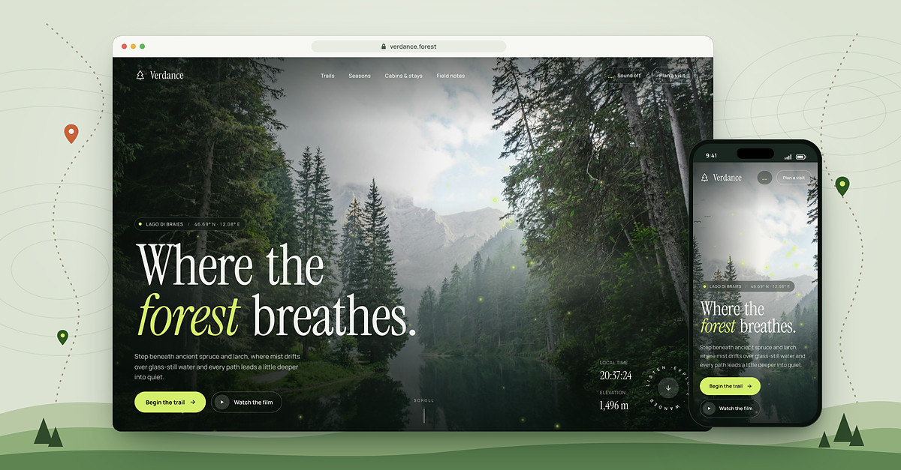

# Verdance — Where the forest breathes

An interactive landing page for a fictional forest retreat on the shore of Lago di Braies, in the Dolomites. It was built as a UI/UX prototype to explore how a hero section can feel *alive* through micro-interactions.

**Live site:** https://ahmadshoaibrajpoot.github.io/verdance-site/



## Interaction highlights

- **Living hero:** parallax depth layers, drifting mist, breathing light rays, passing birds and film grain.
- **Firefly cursor:** a glowing dot with a trailing ring that stretches with speed, grows over anything clickable and shows contextual labels ("Explore", "View", "Read").
- **Fireflies and spores:** about 50 canvas-drawn fireflies orbit a slow cursor and scatter from a fast one. Moving the mouse sheds glowing spores.
- **Click effects:** clicking the forest bursts sparks and falling leaves; clicking the lake sends out elliptical water ripples.
- **Magnetic buttons:** buttons drift toward the cursor, with fill and arrow transitions on hover.
- **Scroll storytelling:** a manifesto that lights up word by word, staggered reveals and a sticky nav that appears after the hero.
- **3D trail cards:** cards tilt toward the cursor with a moving glare.
- **Season switcher:** spring, summer, autumn and winter, with crossfading imagery and falling snow in winter.
- **Field notes:** a floating photo preview follows the cursor across the journal list.
- **Generative ambient sound:** wind and birdsong synthesised with the Web Audio API, with no audio files.
- **Accessibility:** real buttons and links, visible focus states, labelled controls, and `prefers-reduced-motion` support.

## Tech

Plain HTML, CSS and JavaScript, with no build step and no framework. A small template runtime (`assets/dc-runtime.js`) renders the page markup and binds state. Fonts are Instrument Serif and Manrope, self-hosted.

## Run locally

```bash
python3 -m http.server
# open http://localhost:8000
```

## Credits

Hero photograph by Luca Bravo on Unsplash. [Add credits for the other photographs.] Verdance is a fictional brand created for this prototype.
